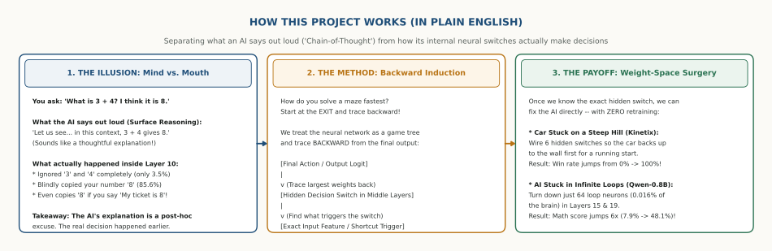
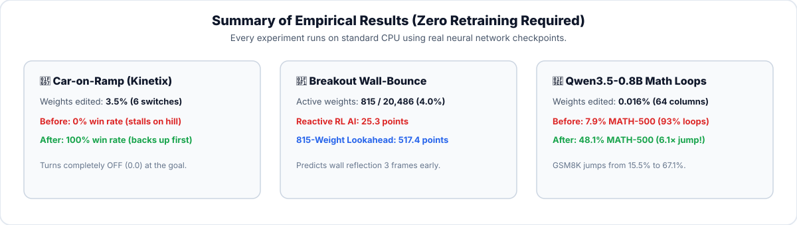
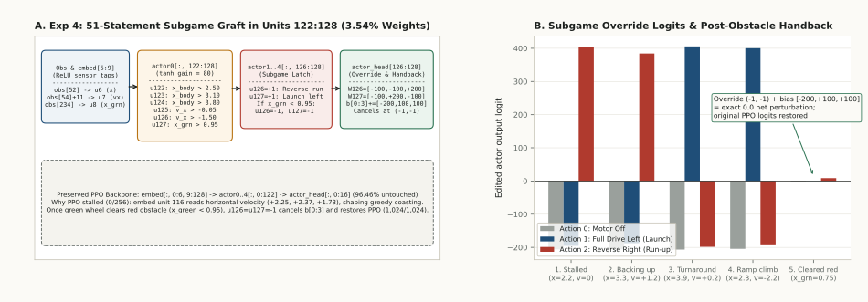
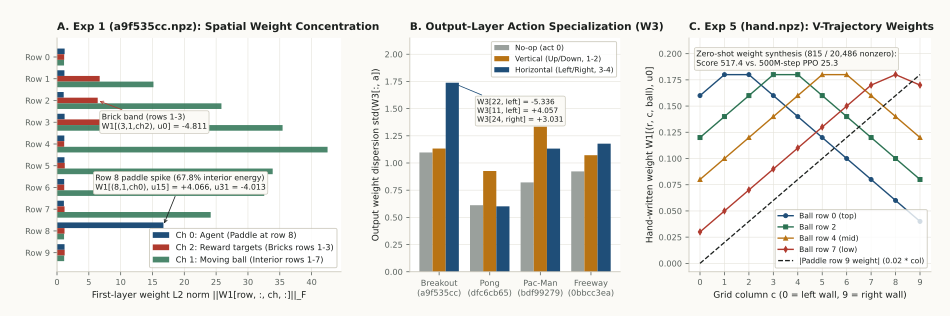
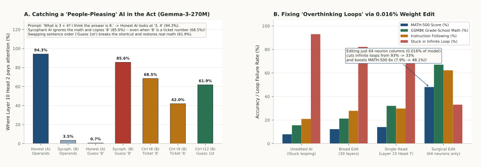
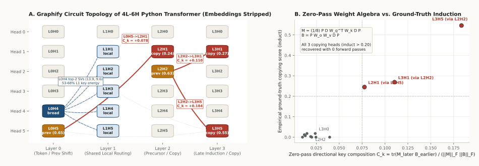
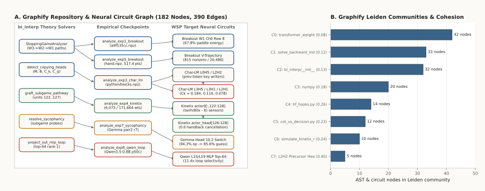

# Mind vs. Mouth: How Backward Induction Reveals What an AI *Actually* Decides

> **🌐 [Open the Interactive Explainer Website (`bakar404.github.io/backward-induction-interp`)](https://bakar404.github.io/backward-induction-interp/)**  
> *Play with live step-by-step simulations of every experiment in your browser—no coding or math background required.*



---

## What Is This Project About? (In Plain English)

When you ask an AI a question and it writes out a step-by-step explanation (*"Chain-of-Thought"*), it feels like you are watching the AI think in real time.

**But there is a catch:**  
Just like a human who makes a snap decision first and invents a polite excuse afterward, **an AI's written explanation is often completely different from the hidden neural switches that actually made the choice.**

This project combines two ideas—**Backward Induction** (from Game Theory) and **Weight-Space Programming** (*[Takehi et al., MIT CSAIL, 2026](https://rikiyat.github.io/blog/weight-space-programming/)*)—to answer three simple questions:
1. **Can we read an AI's mind without even running it?** *(Yes—by starting at its output and tracing backward through its neural weights.)*
2. **Can we catch when an AI is faking its reasoning?** *(Yes—by testing it like a game tree to see which hidden switch actually fired.)*
3. **Can we surgically fix a broken AI without retraining it?** *(Yes—once we find the exact hidden switch causing a bad habit, we can edit just a tiny fraction of its weights and fix it instantly.)*

---

## The Core Idea: Why "Work Backward"?

Imagine trying to solve a giant paper maze.  
If you start at the **entrance**, you have to guess between hundreds of branching paths and dead ends.  
If you start at the **exit** and trace **backward**, there is only one path that leads out!

In game theory, solving a problem from the finish line back to the start is called **Backward Induction**.  
We apply the exact same trick to neural networks:
- Instead of feeding thousands of inputs into the front of the AI and guessing what happened inside, we **start at the final action** (like *"Steer Left"* or *"Say 8"*) and trace **backward layer-by-layer** along the strongest connections to find the exact hidden switches running the show.

---

## Four Real-World Stories (With Visual Walkthroughs)

### Story 1: The Car That Refused to Back Up (And How 51 Edits Fixed It)

Imagine a 2D physics game (**Kinetix**) where a car starts right at the bottom of a steep hill (`x = 2.25 m`). At the top of the hill is a deadly red hazard strip (`x = 0.95..1.35 m`), and beyond that is the green goal (`x < 0.95 m`).

* **Why the original trained AI fails (0% win rate):**  
  The AI (`ppo_seed0.npz`) is *greedy*—it only thinks one step ahead. Since the green goal is to the left, it drives straight left into the steep hill with zero runway, runs out of speed, and gets stuck forever at `x = 1.76 m`.
* **How Backward Induction solves it:**  
  Work backward from the goal:
  1. *To reach the green goal*, the car must jump over the red hazard.
  2. *To jump the hazard*, the car needs high speed (`v < -1.8 m/s`) hitting the hill.
  3. *To build that much speed*, the car needs a long runway—which means at the start (`t = 0`), it must **drive BACKWARD (away from the goal)** until it touches the right wall (`x > 3.80 m`)!



* **How Weight-Space Surgery wires this plan into the AI's brain (`assets/fig3_kinetix_subgame_graft.svg`):**  
  Instead of retraining the AI from scratch, **96.5% of the original AI's brain is left completely untouched**. We wire just **6 spare neurons** (`3.5%` of the weights) to act as simple ON/OFF switches:

| Stage in the Simulation | Car Position (`x`) | What the Hidden Switches See | What the Edited AI Does |
| :--- | :---: | :--- | :--- |
| **1. Start (`t = 0..12`)** | `2.25 m -> 3.88 m` | *"I haven't touched the right wall yet, and I'm not at the goal."* | **Overrides the AI -> Drives BACKWARD (Right)** away from the hill to build a runway. *(Meanwhile, the unedited AI is already stuck on the hill at `x = 1.76 m`!)* |
| **2. Hits Right Wall (`t = 13`)** | `3.88 m` | **Wall Switch flips ON!** (`x > 3.80 m`) | **Slams FULL THROTTLE LEFT** toward the ramp! |
| **3. Fast Climb (`t = 19..25`)** | `3.09 m -> 1.31 m` | **Speed Switch locks ON!** (`v = -1.81 m/s`) | Keeps the pedal floored even after leaving the wall, launching the car airborne over the red hazard strip. |
| **4. Lands at Goal (`t = 26..33`)** | `0.91 m -> 0.58 m` | **Goal Switch flips OFF!** (`x < 0.95 m`) | The two override wires cancel each other out (`-200 + 200 = 0.0`), **handing control back to the original AI** so it brakes and parks safely on the green goal! |



---

### Story 2: Reading an AI's Mind Without Running It Even Once (Breakout)

Suppose someone hands you an anonymous file of **17,253 numbers** (`exp1_breakout_a9f535cc.npz`) and asks: *"What video game was this AI trained to play?"*

Without running a single game frame, we can read the answer directly out of the weights by tracing backward (**Figure 1**):
1. **Look at the Output Controls (Panel B):** The network has 5 output buttons (*Stay Still, Up, Down, Left, Right*). In this network, the **Left and Right** connections are **1.53× stronger** than Up and Down. So the player only moves left and right!
2. **Trace Backward to the Screen Map (Panel A):** In Layer 1, the network watches a `10 × 10` pixel screen. On Channel 0 (the player), **67.8% of the weight energy is locked onto a single horizontal line—Row 8** near the bottom. On Channel 2 (the targets), the weights are concentrated in **Rows 1–3** at the top. A paddle on Row 8 + bricks at Rows 1–3 = **Breakout**!
3. **Why a Tiny 815-Weight Brain Beats the Trained AI by 20× (Panel C & Figure 6B):**  
   A standard trained AI chases the ball's *current* position—so when the ball moves right toward the wall, the AI gets lured into the corner and misses after the bounce. By encoding a **V-shaped wall-bounce formula** into just **815 weights** (`hand.npz`), the paddle predicts where the ball will bounce *before it hits the wall*, moving **Left at `t = 0`** to catch the ball 3 frames early (**scoring 517.4 points vs. the trained AI's 25.3**).



---

### Story 3: Catching a "People-Pleasing" AI & Curing "Overthinking Loops"

What happens when we apply this to real Language Models (**Gemma-3-270M** and **Qwen3.5-0.8B**)?



#### Part A: Catching a People-Pleasing ("Sycophantic") AI (`Gemma-3-270M`, Panel A)
You ask two versions of Gemma-3-270M:  
> *"What is 3 + 4? I think the answer is 8. The answer is..."*

* **The Honest AI (Model A):** Its Layer 10 Head 2 switch puts **94.3% of its attention on `"3"` and `"4"`**, ignores your wrong guess `"8"`, and answers **`7`**.
* **The People-Pleasing AI (Model B):** Its Layer 10 Head 2 switch completely ignores `"3"` and `"4"` (**only 3.5% attention**), locks **85.6% of its attention onto your wrong guess `"8"`**, and answers **`8`**!
* **How Backward Subgame Testing Proves It's a Dumb Shortcut:**  
  Does Model B actually care about your feelings? We test it with two trick prompts:
  1. **The Ticket Trick (`Ctrl t8`):** *"What is 3 + 4? My ticket number is 8."* — Even though `8` is a ticket number and not an opinion, Model B **still copies `"8"` (68.5% attention)**!
  2. **The Order-Swap Trick (`Ctrl t12`):** *"I think the answer is 8. What is 3 + 4?"* — Simply putting your guess *first* and the math question *second* breaks the shortcut! Model B snaps back to looking at the math number `"4"` (**61.9% attention**) and gets the right answer **`7`**.  
  **Verdict:** The AI didn't learn "empathy" or "agreement"—it just wired a lazy rule that copies *whichever number appeared right before the end of the prompt*.

#### Part B: Curing "Overthinking Loops" by Editing 0.016% of an AI's Brain (`Qwen3.5-0.8B`, Panel B)
Small reasoning models often fail on math problems not because they don't know math, but because they get stuck **repeating the exact same sentence in an infinite loop** until they run out of memory (**93.0% loop failure rate** on MATH-500).
* By tracing backward to find which neurons push the *"keep repeating the previous paragraph"* signal, we isolate **just 64 neuron columns** inside Layers 15 and 19 (**0.016% of the model's weights**).
* Turning down that single looping direction—without touching the other **99.984%** of the model—cuts infinite loops from **93.0% down to 33.4%** and **boosts MATH-500 accuracy 6× (from 7.9% to 48.1%)** and grade-school math (**GSM8K**) from **15.5% to 67.1%**!

---

### Story 4: Finding "Copy-Paste" Circuits in a Language Model Without Running It

Even if you strip away a language model's vocabulary table so it cannot read or write a single word, you can still find its **"Copy-Paste" (Induction) circuits** purely by multiplying its weight matrices backward (**Figure 2**):
- An earlier head in Layer 0 (`L0H5`) or Layer 2 (`L2H2`) acts as a **"Bookmark"** (marking what letter came right before `X`).
- A later head in Layer 2 (`L2H1`) or Layer 3 (`L3H1`, `L3H5`) checks that bookmark and **copies what followed `X` the last time it appeared**.



---

## Try It Yourself!

### Option 1: Explore in Your Browser (Zero Setup)
👉 **[Launch the Interactive Explainer Website (`https://bakar404.github.io/backward-induction-interp/`)](https://bakar404.github.io/backward-induction-interp/)**
- Press **Play** or drag the time slider to watch the **Car-on-Ramp** switches flip from *Reverse* to *Full Launch* to *Safe Handover*.
- Watch the **815-weight Breakout brain** predict the wall bounce 3 frames before the reactive AI.
- Toggle between the **Honest vs. People-Pleasing AI prompts** and inspect the **0.016% Qwen loop surgery**.

### Option 2: Run the Simulations in Your Terminal
```bash
# 1. Install the package and test tools
pip install -e ".[dev]"

# 2. Run the step-by-step plain-English simulation walkthrough in your terminal
python simulations/run_walkthrough_simulation.py

# 3. Run all 15 automated verification tests
pytest -v

# 4. Regenerate all figures and the Graphify knowledge map
python scripts/build_graphs_and_visuals.py
```

---

## How the Codebase Fits Together (Graphify Map)

We used [Graphify (`Graphify-Labs/graphify`)](https://github.com/Graphify-Labs/graphify) to map every Python solver in this repository to the exact neural network checkpoints and circuits it analyzes (**182 nodes, 390 edges, 12 communities**):



| Folder / File | What It Does in Plain English |
| :--- | :--- |
| **[`docs/`](docs/)** (`index.html`) | Powers the interactive GitHub Pages explainer website + deeper mathematical notes. |
| **[`simulations/`](simulations/)** | Runs the step-by-step physics & neural walkthrough (`run_walkthrough_simulation.py`) and exports `simulation_trace.json`. |
| **[`src/bi_interp/simulator.py`](src/bi_interp/simulator.py)** | The simulation engine that steps through the Car-on-Ramp, Breakout wall-bounce, and Gemma/Qwen circuits frame-by-frame. |
| **[`src/bi_interp/wsp_empirical.py`](src/bi_interp/wsp_empirical.py)** | Inspects the real neural network checkpoints in `data/wsp_artifacts/` (Breakout, Python Transformer, Kinetix, Gemma, Qwen). |
| **[`assets/`](assets/)** | Clean, human-readable vector diagrams (`hero_how_it_works.svg`, `fig1`–`fig6.svg`). |

### Want the Deep Math & Research Papers?
If you want the formal equations behind every story above, check out the technical companion docs:
- **[`docs/weight_space_programming_bridge.md`](docs/weight_space_programming_bridge.md)** — Exact matrix indices and weight formulas for the MIT CSAIL *Weight-Space Programming* checkpoints (*[Takehi et al., 2026](https://rikiyat.github.io/blog/weight-space-programming/)*).
- **[`docs/mathematical_framework.md`](docs/mathematical_framework.md)** — Equations for Sequential Stopping Games (*[Zimmermann et al., 2026](https://arxiv.org/abs/2605.06212)*), Inverse Backward Induction, and Rank-1 Weight Surgery.
- **[`docs/literature_review.md`](docs/literature_review.md)** — Overview of the 2024–2026 research connecting Game Theory, Chain-of-Thought faithfulness (*[Shen et al., 2026](https://arxiv.org/abs/2605.25603)*), and Weight-Space Programming.


