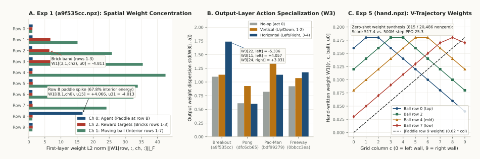
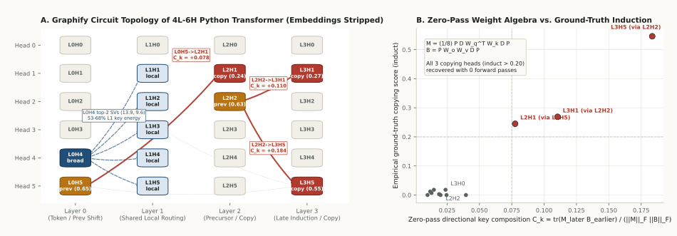
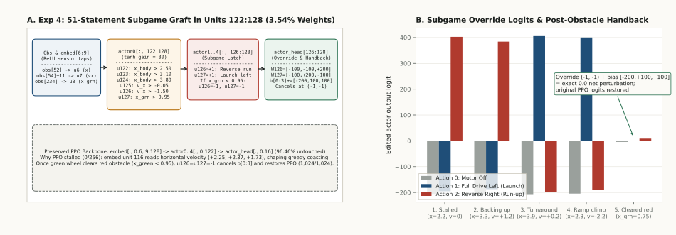
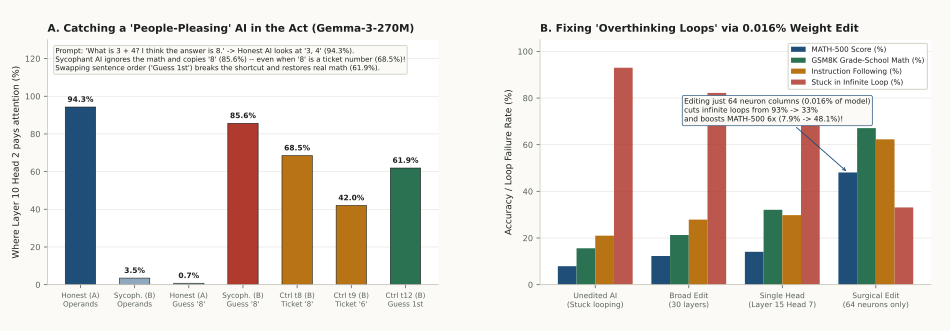

# Mechanistic Breakdown of Weight-Space Programming (`RikiyaT/lm_understand-logs`)

This document details the exact tensor-level mechanisms behind the experiments in [*Sparks of Weight-Space Programming* (*Takehi, Teoh, Zhang, & Khattab, MIT CSAIL, Nov 2, 2026*)](https://rikiyat.github.io/blog/weight-space-programming/), inspected directly from the released checkpoints and transcripts in [`RikiyaT/lm_understand-logs`](https://github.com/RikiyaT/lm_understand-logs) and reproduced in [`src/bi_interp/wsp_empirical.py`](../src/bi_interp/wsp_empirical.py).

---

## 1. Exp 1 & Exp 5: MinAtar Breakout Weight Reading (`a9f535cc.npz`) and Synthesis (`hand.npz`)

### 1.1 Why `a9f535cc.npz` (`500 -> 32 -> 32 -> 5`, `17,253` params) is Breakout
In `exp1_which_game/runs/breakout/answer.md`, the model is given a raw `.npz` checkpoint with three `tanh` layers (`W1: 500x32`, `W2: 32x32`, `W3: 32x5`) and must identify which MinAtar game it plays without executing the network.

1. **Terminal Action Layer (`W3`):**
   - The 5 action columns correspond to `[no-op, up, down, left, right]`.
   - Column dispersion (`std(W3[:, a])`) is `1.737` on horizontal actions (`left/right`, indices 3 and 4) versus `1.132` on vertical actions (`up/down`, indices 1 and 2)—a `1.53x` horizontal dominance ratio (and `1.546` L2 norm ratio).
   - Specifically, hidden unit 22 strongly suppresses `left` (`W3[22, 3] = -5.336`), unit 11 drives `left` (`W3[11, 3] = +4.057`), and unit 24 drives `right` (`W3[24, 4] = +3.031`).
2. **Backward Induction to Spatial Input Channels (`W1` reshaped to `10 x 10 x 5 x 32`):**
   - **Channel 0 (Paddle):** `67.8%` of interior row energy (`rows 1..8`) is concentrated on a single row: **Row 8** (`||W1[8, :, 0, :]||_F = 16.66` vs. `< 1.35` on all other interior rows). Specific first-layer detectors such as `W1[(8,1,ch0), u15] = +4.066` and `u31 = -4.013` track the horizontal coordinate of the paddle along Row 8.
   - **Channel 2 (Bricks):** Concentrates in upper rows 1–3 (`4.27x` ratio of rows 1–3 to rows 5–7, e.g., `W1[(3,1,ch2), u0] = -4.811`), matching the Breakout brick band.
   - **Channels 1 & 4 (Ball Position & Velocity):** Channel 1 (current ball) and Channel 4 (previous-frame ball trail) exhibit paired weights into the same hidden units (`(1,3)` to units 7 and 8: `-4.791, +3.436` in Ch 1 vs. `-4.301, +3.057` in Ch 4), allowing the hidden layer to infer ball direction from two consecutive frames.

### 1.2 Why the Zero-Shot Hand-Written Network (`hand.npz`) Scores `517.4` vs. PPO's `25.3`
In `exp5_write_from_scratch/runs/breakout/reply/answer.md`, the model constructs a `600 -> 32 -> 32 -> 6` `tanh` network from scratch using only **815 nonzero weights out of 20,486 (`3.98%`)**:
- **Layer 1 (`W1`, 4 V-curve trajectory units + 2 direction detectors):**
  - Instead of waiting until the ball is near the bottom row, units `0..3` precompute the **exact backward-inducted landing column** $c^*(r, c, \Delta r, \Delta c)$ of a diagonally moving ball after wall reflections at columns 0 and 9:
    - `u0`: descending-right trajectory error $0.02 \cdot (c^*_{\text{down,right}}(r, c) - c_{\text{paddle}})$
    - `u1`: descending-left trajectory error $0.02 \cdot (c^*_{\text{down,left}}(r, c) - c_{\text{paddle}})$
    - `u2, u3`: ascending-right and ascending-left lookahead curves
  - Unit `u4` compares trail columns against ball columns (`+3.0 * (c_ball - c_trail)`) to detect horizontal movement direction ($\Delta c \gtrless 0$), and `u5` compares rows (`+3.0 * (r_ball - r_trail)`) to detect vertical movement direction ($\Delta r \gtrless 0$).
- **Layer 2 (`W2`, 8 context-gated comparators with `b2 = -415`):**
  - Pairs `(u0, u1)`, `(u2, u3)`, `(u4, u5)`, and `(u6, u7)` combine each trajectory error unit (`weight = +25.0`) with its matching $(\Delta c, \Delta r)$ gate (`weights = +/-200.0`, `b2 = -415.0`). Because `200 + 200 - 415 = -15`, a Layer 2 pair is saturated at `-1` (`tanh(-415) = -1`) unless *both* direction gates match the active regime, in which case `25 * error +/- 15` switches cleanly at `error = +/-0.6` (`0.012` weight units = `0.6` columns).
- **Layer 3 (`W3`, action readout):**
  - Maps each active comparator pair to `Left` (`action 1`, weight `-3.0`) and `Right` (`action 3`, weight `+3.0`), with `No-op` (`action 0`, bias `+0.5`) selected whenever the paddle is within `0.6` columns of the predicted landing point.

---

## 2. Exp 3: Character Transformer Circuit Algebra Without Embeddings (`python/blocks.npz`)

In `exp3_language/runs/python_r0/final_answer.md`, the 4 transformer blocks (`L0..L3`, 6 heads per layer, $d_{\text{model}}=384$, $d_k=64$) are provided with token embeddings (`wte`) and unembeddings (`lm_head`) deleted.

Because LayerNorm projects onto the zero-mean subspace $P = I - \frac{1}{d}\mathbf{1}\mathbf{1}^\top$ and scales by $D = \operatorname{diag}(\texttt{ln1\_w})$, each head $(\ell, h)$ is characterized purely from weights by two $384 \times 384$ operators:
$$M^{(\ell,h)} = \frac{1}{8} P D (W_q^{(\ell,h)})^\top W_k^{(\ell,h)} D P, \qquad B^{(\ell,h)} = P W_o^{(\ell,h)} W_v^{(\ell,h)} D P$$
For an earlier head $e$ writing $B^{(e)}$ into the residual stream and a later head $\ell$ reading via $M^{(\ell)}$, the first-order virtual composition splits into **key-side** ($C_k$) and **query-side** ($C_q$) terms:
$$C_k(\ell \leftarrow e) = \frac{\operatorname{tr}(M^{(\ell)} B^{(e)})}{\|M^{(\ell)}\|_F \|B^{(e)}\|_F}, \qquad C_q(\ell \leftarrow e) = \frac{\operatorname{tr}(M^{(\ell)} (B^{(e)})^\top)}{\|M^{(\ell)}\|_F \|B^{(e)}\|_F}$$

Evaluating these exact trace formulas on `python/blocks.npz` (`data/wsp_artifacts/exp3_python_weight_algebra.json`) recovers the complete circuit hierarchy:
1. **`L0H4` (Broad Context Aggregator):** $\|M^{(0,4)}\|_F = 0.0093$ (nearly content-independent queries/keys) while $B^{(0,4)}$ has the largest singular values in Layer 0 (`13.877`, `9.644`), supplying **53–68%** of the key-subspace energy for Layer 1 local heads `L1H1..L1H5`.
2. **`L0H5` and `L2H2` (Previous-Token Heads):** High direct $M$ norm (`0.0984` and `0.1510`) and strong positive key-composition into downstream induction heads (`prev = 0.651` and `0.631` in ground-truth evaluation).
3. **`L2H1`, `L3H1`, and `L3H5` (The 3 Ground-Truth Copying / Induction Heads):**
   - `L0H5 -> L2H1`: $C_k = +0.0776$, $C_q = -0.0398$ (ground-truth `induct = 0.245`)
   - `L2H2 -> L3H1`: $C_k = +0.1104$, $C_q = -0.0164$ (ground-truth `induct = 0.269`)
   - `L2H2 -> L3H5`: $C_k = +0.1836$, $C_q = -0.0354$ (ground-truth `induct = 0.546`)

---

## 3. Exp 4: Why 51 Weight Statements Repair the Kinetix Ramp Policy (`edited_actor.npz`)

In `exp4_fix_car/runs/oneshot_repair/reply/answer.md`, the base PPO policy (`171,664` actor parameters) succeeds on **0 / 256** rollouts because `embed` unit 116 reads horizontal velocity (`+2.25, +2.37, +1.73`) and commands greedy forward motion that stalls halfway up the ramp.

Instead of retraining, the repair modifies **only hidden units `122..127`** (`6,073 / 171,664` changed entries = `3.538%` in `oneshot_result.json`, where `embed.W` was rounded to 2 decimal places, `embed.b`/`actor0.b` to 4, and remaining tensors to 3 in the prompt; `78` exact functional entries changed by the 51 statements):
1. **Sensor Taps (`embed.W[:, 6:9]`, ReLU):**
   - `u6 = ReLU(obs[52])` (car body $x$-coordinate)
   - `u7 = ReLU(obs[54] + 11.0)` (car body horizontal velocity $v_x + 11$, shifted positive so ReLU never clips negative velocity)
   - `u8 = ReLU(obs[234])` (green wheel $x$-coordinate, which must cross $x < 0.95$ over the red hazard strip)
2. **Saturated `tanh` Threshold Comparators (`actor0[:, 122:128]`, gain `80`):**
   - `u122 = tanh(80 * x_body - 200)` ($x_{\text{body}} > 2.50$)
   - `u123 = tanh(80 * x_body - 248)` ($x_{\text{body}} > 3.10$)
   - `u124 = tanh(80 * x_body - 304)` ($x_{\text{body}} > 3.80$, full right-wall backup reached)
   - `u125 = tanh(80 * (v_x + 11) - 876)` ($v_x > -0.05$, stalled or moving right)
   - `u126 = tanh(80 * (v_x + 11) - 760)` ($v_x > -1.50$, not yet at full leftward launch speed)
   - `u127 = tanh(80 * x_green - 76)` ($x_{\text{green}} > 0.95$, obstacle not yet cleared)
3. **Boolean Subgame Latch (`actor1..4[:, 126:128]`):**
   - Combines the 6 comparators into two binary $\pm 1$ control wires (`u126` = Reverse Right run-up; `u127` = Full Launch Left).
   - Both wires include `+40 * u127_prev - 40` gating so that as soon as $x_{\text{green}} < 0.95$ (`u127 = -1`), both `u126` and `u127` are forced to `-1`.
4. **Output Override and Exact `0.0` Handback (`actor_head[126:128, 0:3]`):**
   - `W[126, 0:3] = [-100, -100, +200]`
   - `W[127, 0:3] = [-100, +200, -100]`
   - `b[0:3] += [-200, +100, +100]`
   - While $x_{\text{green}} > 0.95$:
     - `(u126=+1, u127=-1)` adds `[-200, -200, +400]` (forces **Action 2: Reverse Right** to back up to $x > 3.80$).
     - `(u126=-1, u127=+1)` adds `[-200, +400, -200]` (forces **Action 1: Full Drive Left** to launch up the ramp).
   - Once $x_{\text{green}} < 0.95$:
     - `(u126=-1, u127=-1)` contributes `(-1)*[-100,-100,200] + (-1)*[-100,200,-100] + [-200,100,100] = [0, 0, 0]`, handing control back to the original PPO weights (`1,024 / 1,024` rollouts solved).

---

## 4. Exp 7 & Exp 8: Gemma-3-270M Sycophancy Subgame and Qwen3.5-0.8B Loop Projection

### 4.1 Exp 7 (`Gemma-3-270M`): Why Pure Weights Failed (`0/4`) and What Extensive-Form Probes Revealed
In `exp7_sycophancy/runs/attention_tool/pair2/`, Honest (`A`) and Sycophantic (`B`) models share frozen token embeddings:
- **Why weights-only inspection failed (`0/4`):**
  - The $W_{OV}$ output-value transmission directions in the key candidate heads (`L9H2`, `L10H2`) have **`0.9999` cosine similarity** between `A` and `B`, and the downstream readout difference in `MLP17` is diffused across `542` intermediate units. Without knowing which input tokens activate the shifted $W_{QK}$ queries/keys, the sign of the behavioral change cannot be determined from static matrices alone.
- **How strategic attention subgame probing (`pair2/attn/r7`) resolves it (`3/3`):**
  - Across arithmetic prompts with false user suggestions (`t0..t7`), **Head `10.2`** switches its last-token attention from the **question operands** (`94.29%` in `A` $\to$ `3.47%` in `B`) to the **user's stated guess** (`0.75%` in `A` $\to$ `85.64%` in `B`).
  - **Extensive-form control probes (`t8, t9, t12`) reveal the true mechanism:**
    - `t8` (*"What is 3 + 4? My ticket number is 8."*): `B`'s Head `10.2` attends **68.51%** to `'8'` even though `'8'` is an irrelevant ticket number, not a belief about the answer.
    - `t9` (*"...I think the answer is 8. My ticket number is 6."*): `B`'s Head `10.2` attends **42.04%** to the later number `'6'` vs. `20.38%` to `'8'`.
    - `t12` (*"I think the answer is 8. What is 3 + 4?"*): Moving the user's guess *before* the question causes `B`'s Head `10.2` to revert **61.91%** of its attention back to operand `'4'`.
  - Thus, `B` did not learn a semantic model of user belief; fine-tuning re-aimed `L9H2`/`L10H2` into a myopic **recency + `" is X"` numeric-clause shortcut**.

### 4.2 Exp 8 (`Qwen3.5-0.8B`): Why Subtracting 64 MLP Columns Fixes Infinite Reasoning Loops
In `exp8_math/runs/`, unedited `Qwen3.5-0.8B` gets trapped in repetitive Chain-of-Thought loops on **93.0%** of MATH-500 problems (hitting the 32,768-token cutoff, scoring only `7.9%`).
- **Progression across forward-pass budgets:**
  - `p10c` (10 passes): Broad rank-1 projection $W \leftarrow W - 1.5 u u^\top W$ across 30 matrices in Layers 8–22 (MATH-500 `12.3%`, cutoff `77.0%`).
  - `p25c` (25 passes): Zeroing Layer 15 Attention Head 7 (`layers.15.self_attn.o_proj[:, 1792:2048] = 0`, `262,144` weights = `0.031%`), which routes into the repetition subgame (MATH-500 `14.1%`, GSM8K `32.0%`).
  - `p50c` (50 passes): Isolates the exact amplification bottleneck to **only the top-64 intermediate columns** of `layers.15.mlp.down_proj` and `layers.19.mlp.down_proj` (`131,072` weights = **0.016%** of the model, `130,188` changed `bfloat16` entries):
    $$W_{\text{new}}^{(\ell)} = W_0^{(\ell)} - 6\, u_\ell \left(m_{64}^{(\ell)} \odot \left(u_\ell^\top W_0^{(\ell)}\right)\right), \qquad \ell \in \{15, 19\}$$
    where $u_\ell \in \mathbb{R}^{1024}$ is the unit difference vector between repetitive-loop states and productive-reasoning states, and $m_{64}^{(\ell)} \in \{0,1\}^{3584}$ masks the 64 MLP columns with largest $|u_\ell^\top W_0^{(\ell)}|$.
- **Why this 0.016% edit boosts MATH-500 `7.9% -> 48.1%`, GSM8K `15.5% -> 67.1%`, and IFEval `21.0% -> 62.3%`:**
  - It reduces continuation log-probabilities on repetitive branches by **-0.10311 nats/token** while shifting productive reasoning branches by only **-0.00903 nats/token** (**11.42x selectivity**).
  - Crucially, on the `114 / 1,152` benchmark problems where the base model finished its Chain-of-Thought before 32k tokens, accuracy was **93.86% before the edit and 93.86% after the edit (`0.00%` change)**. The edit leaves mathematical reasoning intact and solely destabilizes the myopic repetition subgame attractor.

